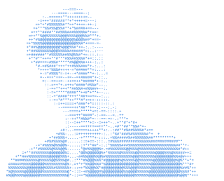

# Hi, I'm Dinis 👋

### Applied Mathematics Student @ FCUP (University of Porto)

---

<table>
<tr>
<td valign="top">
<picture>
  <source media="(prefers-color-scheme: dark)" srcset="assets/ascii-dark.svg">
  <source media="(prefers-color-scheme: light)" srcset="assets/ascii-light.svg">
  
</picture>
</td>
<td valign="top">
<pre>
dinis@fcup -----------------------------------------
University: ............ FCUP, University of Porto
Degree: ................ BSc Applied Mathematics
Year: .................. 3rd Year
-
Focus Areas: ........... Data Science, AI, Modelling
Currently Learning: .... Java, Databases
-
Languages.Programming: . Python, Java
Languages.Math: ........ SageMath, LaTeX
Languages.Real: ........ Portuguese, English (B2)
-
Interests: ............. Motorbikes, Sports, Running
Contact --------------------------------------------
Email: ................. martinsdinislopes@gmail.com
Email.University: ...... up202407175@up.pt
</pre>
</td>
</tr>
</table>

---

## 🚀 About Me

I'm a 3rd-year **Applied Mathematics** student at **FCUP** (Faculdade de Ciências da Universidade do Porto). I enjoy turning theory into tools: using mathematics and code to model problems, find patterns in data and build solutions that work in the real world.

I'm especially drawn to the space where mathematics meets computing: **data science**, **machine learning** and **quantitative modelling**. I also work as a **math tutor**, teaching students from secondary school up to university level, which taught me to explain complex ideas clearly.

## 🔍 Currently Exploring

- 📊 **Data analysis with Python**: getting back to pandas and NumPy with real datasets
- 🤖 **Machine Learning**: building a solid mathematical foundation first
- ☕ **Java & databases**: object-oriented programming and SQL, as part of my degree
- 🌱 **Git & GitHub**: version control for everything I build from now on

## 🏃 Outside of Code

- 🤾 Played competitive **handball** for 8 years (CD Feirense, FC Gaia) and briefly worked as an **assistant coach** for an U-16 team
- 🏍️ Passionate about **motorbikes** and road trips
- 🏃 Running to stay balanced
- 🤝 Volunteered with **Banco Alimentar** (food bank) and **Liga dos Amigos do Hospital de São Sebastião**

---

## 📫 Where to Find Me

---

## 🛠️ Tech Stack

**Languages**

**Mathematics & Scientific Writing**

**Data**

**Currently Learning**

**Tools**

